<p align="center">
  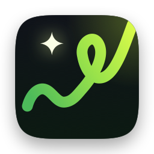
</p>

<h1 align="center">Freefield</h1>

<p align="center">
  <b>A free, open-source AI image and video studio for the Mac.</b><br>
  No subscription and no credits. You use your own API key and pay only for what you generate.
</p>

<p align="center">
  
  
  
  
</p>

<p align="center">
  <a href="https://github.com/anthonyfuar/freefield/releases/latest/download/Freefield.zip"></a>
</p>

<p align="center">
  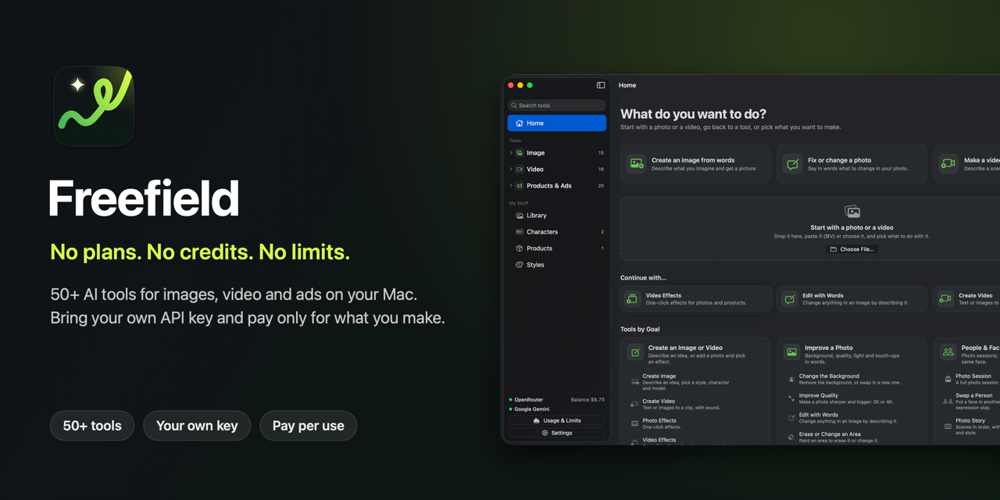
</p>

Freefield does what Higgsfield does for images and video: create images, fix photos, make videos up to 4K, apply one-click effects and make ads. It's a native Mac app with 50+ tools. The difference is how you pay.

## Freefield vs. Higgsfield

Higgsfield sells monthly plans. A plan is a bundle of credits, and the credits you don't use expire at the end of the month. Freefield has no plan. You add money to your own [OpenRouter](https://openrouter.ai) or Google account, and each generation costs what the model's provider charges. Whatever you don't spend stays in your account.

**What each Higgsfield plan buys, and what the same money buys in Freefield.** Each cell reads *Higgsfield → Freefield*.

| Higgsfield plan | Price | Seedream 4.5 images | Seedance 2.0 Fast videos, 5 s | Seedance 2.0 videos, 5 s | Veo 3.1 Fast videos, 8 s |
|---|---|---|---|---|---|
| Starter | $15 / month | 200 → **375** | 16 → **32** | not included → **19** | not included → **18** |
| Plus | $49 / month | 1,000 → **1,225** | 83 → **107** | 45 → **64** | 31 → **61** |
| Ultra 3k | $129 / month | 3,000 → **3,225** | 250 → **282** | 136 → **169** | 93 → **161** |
| Ultra 6k | $250 / month | 6,000 → **6,250** | 500 → **546** | 272 → **327** | 187 → **312** |
| Ultra 9k | $375 / month | 9,000 → **9,375** | 750 → **819** | 409 → **491** | 281 → **468** |

The Higgsfield numbers assume you spend every credit before it expires. Videos are 720p.

Not every model is cheaper in Freefield. On Plus and bigger plans, Higgsfield prices a few models, such as Nano Banana Pro and Kling 3.0, below what the providers charge. If you use up the whole plan, you get more of those (500 vs. 365 Nano Banana Pro images on Plus). The [full comparison](#full-price-comparison) below has every model, both ways.

### What a month actually costs

Most people don't use 100% of a plan. Here is what a few real months cost:

| Your month | Higgsfield | Freefield |
|---|---|---|
| 30 images and 4 short videos | $15 (Starter, the smallest paid plan) | **$3.03** |
| 300 images and 30 short videos | $49 (Plus: they don't fit in Starter's 200 credits) | **$25.71** |
| A month you're busy and make nothing | $15 to $375, and the credits expire | **$0** |

Images are Seedream 4.5 and videos are 5-second 720p Seedance 2.0 Fast clips. Prices were checked on October 23, 2026. OpenRouter adds a fee of about 5.5% when you top up.

## What's inside

| Start with a photo or a goal | Every option shows a picture of what it does |
|---|---|
| 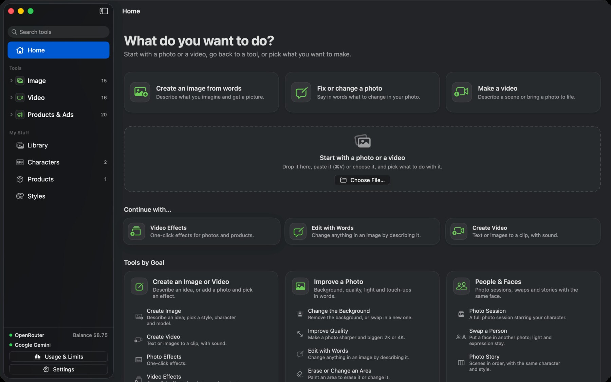 | 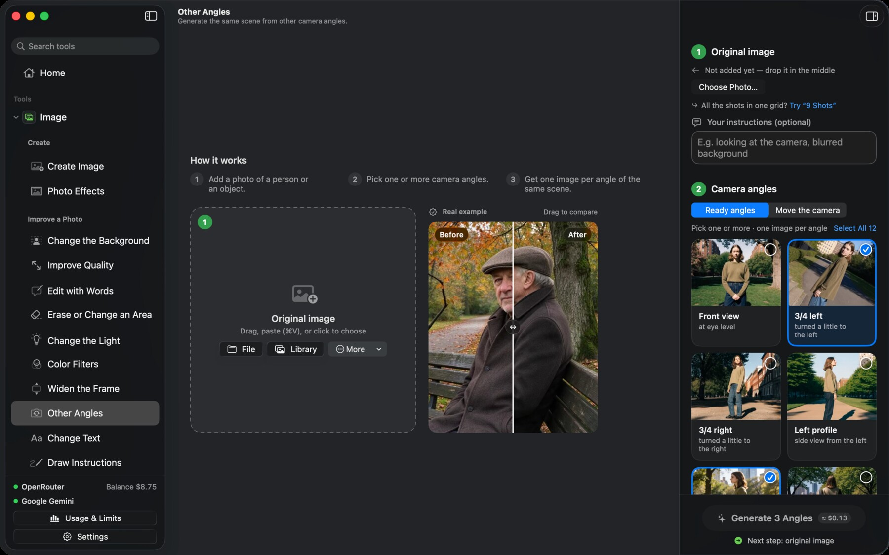 |
| **Create an image** | **56 one-click photo effects** |
| 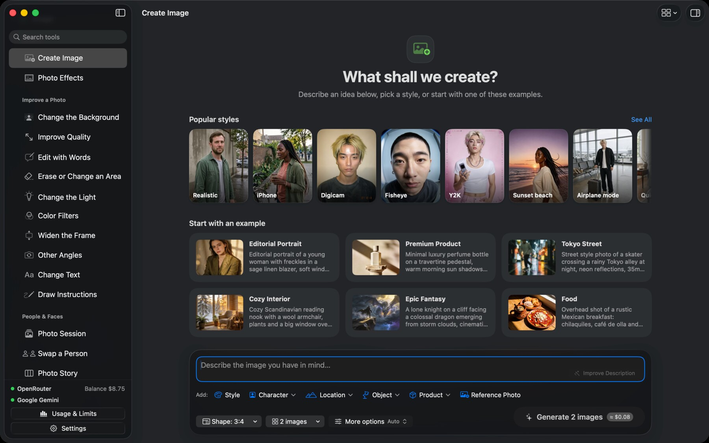 | 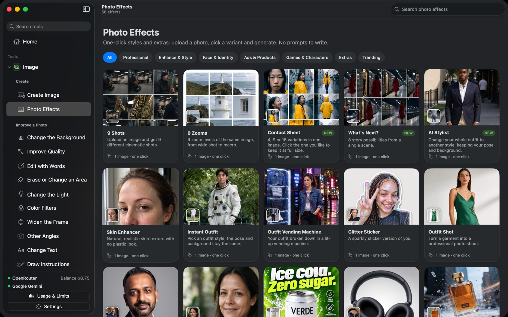 |
| **Product photos and ads** | **Video up to 4K, with the price of each size** |
| 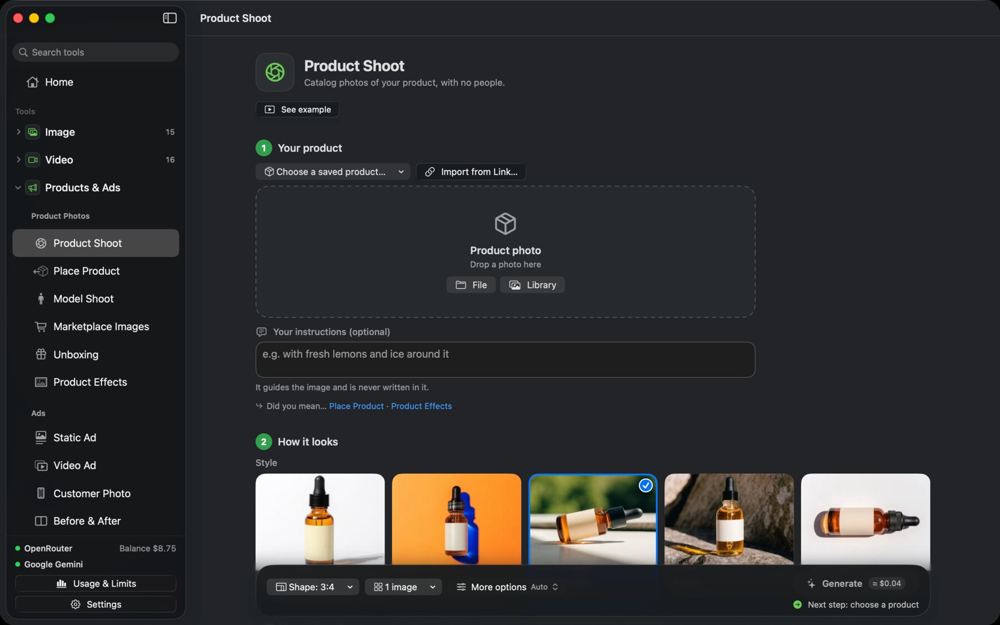 | 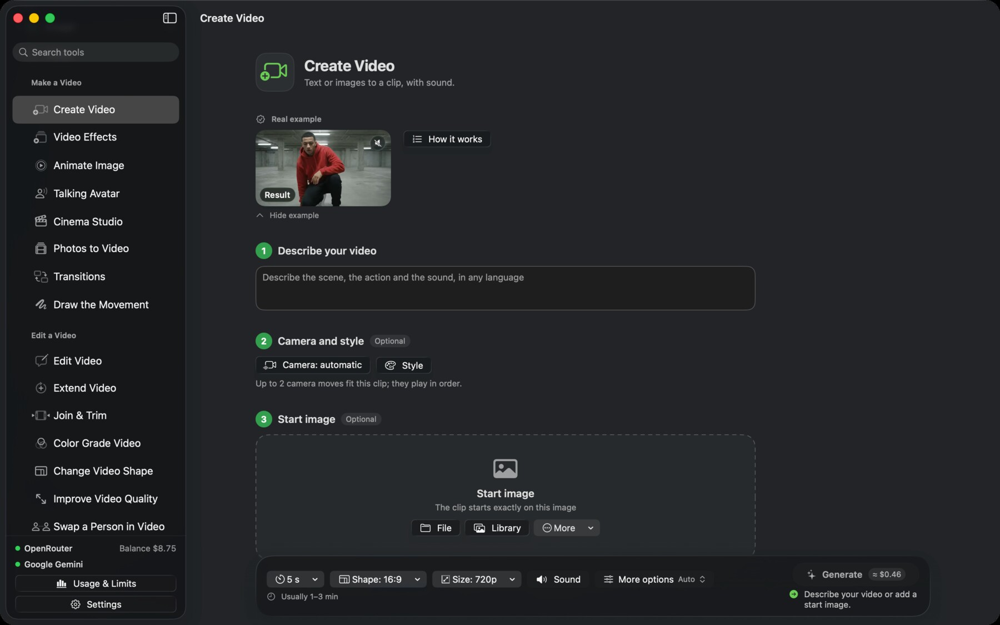 |
| **Edit with words** | **133 one-click video effects** |
| 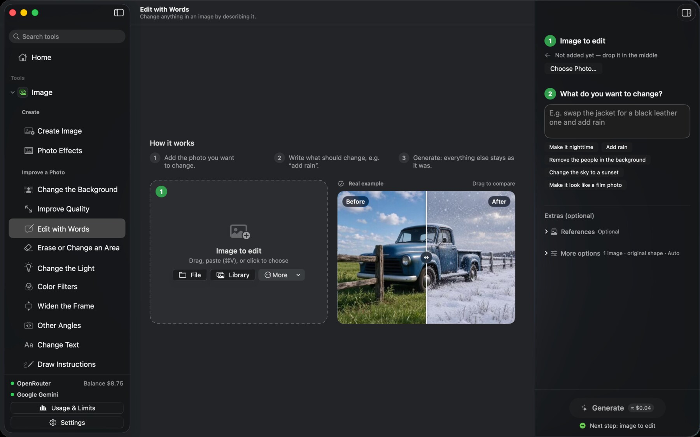 | 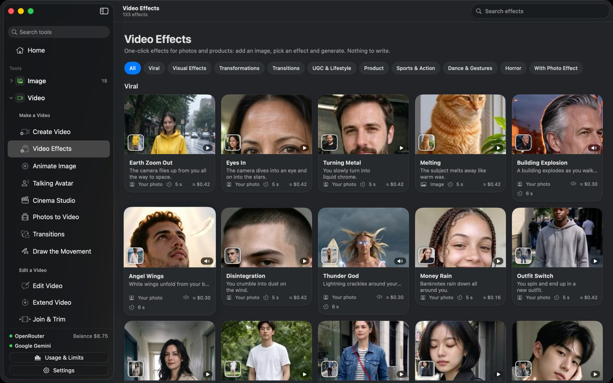 |
| **172 styles and your own moodboards** | **What you spent, and spending limits** |
| 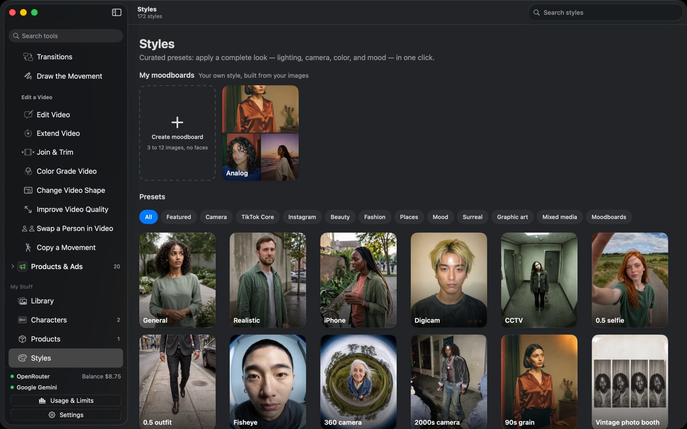 | 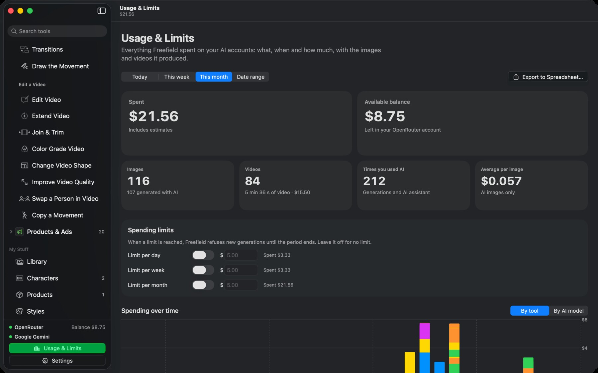 |

The menu is organized like Higgsfield's, by type:

- **Image:** create images from a sentence in 172 styles, with up to 5 of your saved people, a place and objects in the same picture. Remove or swap a background, upscale to 4K, change the light or the camera angle, edit with words, erase things, and make photo sessions and stories that keep the same face.
- **Video:** turn text or a photo into a clip with sound, up to 4K. 133 one-click effects, 72 camera moves, talking avatars, a director's panel for film-style shots, and transitions. Edit clips too: restyle, extend, join and trim, color grade, reframe for vertical, upscale, or swap a person.
- **Products & Ads:** studio and model photos of your product, marketplace image sets, static ads, carousels and video ads. Make a batch of ads at once, test headlines, resize or translate an ad, and keep your logo and colors with a Brand Kit.

Every tool shows a real before-and-after example made with that tool, and has a "Your instructions" box for anything the options don't cover. The interface is in English and Spanish.

## Get started

You need a Mac with Apple silicon running **macOS 26 Tahoe**.

1. **[Download Freefield.zip](https://github.com/anthonyfuar/freefield/releases/latest/download/Freefield.zip)** from the [latest release](https://github.com/anthonyfuar/freefield/releases/latest) and double-click it to unzip.
2. Drag **Freefield** to your **Applications** folder.
3. Open it. The first time, macOS says it can't verify the developer, because the app isn't signed with a paid Apple certificate. Click **Done**, then open **System Settings ▸ Privacy & Security**, scroll down and click **Open Anyway**. You only do this once.

A short guide then asks for a key:

| Provider | What you get | Get a key |
|---|---|---|
| **OpenRouter** (recommended) | Every model with one key: Nano Banana, Seedream, GPT Image, FLUX, Recraft, Grok, Seedance, Kling, Veo and more. You also see the real cost of each request. | [openrouter.ai/settings/keys](https://openrouter.ai/settings/keys) |
| **Google Gemini** | The Nano Banana image models and Gemini Omni Flash video (3 to 10 s with sound, about $0.10 per second; billing must be on). Other video models need OpenRouter. | [aistudio.google.com/apikey](https://aistudio.google.com/apikey) |

Models your key can't use stay visible but greyed out, with the reason.

## FAQ

**Is it really free?** The app is. You pay the AI provider for what you generate, at their price, with your own key. Freefield never charges you anything.

**How do I know what something costs before I make it?** The Generate button shows the estimate, and a video that costs $1 or more asks first. Afterwards, Usage & Limits records the real cost.

**Can I cap my spending?** Yes. Set a daily, weekly or monthly limit, and Freefield refuses new jobs once you reach it.

**Do I need Xcode?** No. Only building from source needs Apple's free Command Line Tools.

**Why does macOS warn me the first time?** Apps from outside the App Store need a paid Apple certificate to open without a warning. Freefield doesn't have one, so macOS asks once.

**Does it work offline?** Your library, color filters, video color grading and Join & Trim do. Generating needs the provider.

**Is my content used to train models?** Freefield sends your files only to the provider you chose. That provider's own policy applies.

## What things cost

| Example | Typical cost |
|---|---|
| One image with FLUX 3 Klein | ≈ $0.01 |
| One image with Seedream 4.5 or GPT Image 2.5 | ≈ $0.04 |
| One image with Nano Banana Pro | ≈ $0.13 |
| A 5-second clip with sound (Seedance 2.0 Fast, 720p) | ≈ $0.46 |
| The same clip in 1080p / 4K (Seedance 2.0) | ≈ $1.89 / ≈ $3.92 |
| Reading the text in a photo, checking a face, tracking a subject | less than $0.01 |
| Color filters, video color grading, joining and trimming clips | free, done on your Mac |

## All tools

<details>
<summary><b>Image</b></summary>

| Tool | What it does |
|---|---|
| **Create Image** (⌘1) | A description, model, style, character, product and up to 14 reference images. Aspect ratio, 1K/2K/4K, 1 to 4 images, quality, seed and transparent background. |
| ↳ People, places and objects | Up to 5 saved people in the same scene, each keeping their own face, plus a saved place and objects. Type @ in the description to mention them by name. |
| ↳ Style | 172 looks with thumbnails in 11 categories, including 33 Mixed Media looks such as collage, paper cut-out, paint and comic, plus your own moodboards. |
| ↳ Camera and color | 15 camera bodies and 27 lenses (16 mm film, anamorphic, ARRI Alexa 35, Cooke S4 and others), 6 focal lengths, 3 apertures, and color palettes, including one taken from any image. |
| ↳ Improve description | Rewrites a short idea as a detailed description for about $0.001. It can run automatically in every tool. |
| **Photo Effects** | 56 one-click effects in 7 categories: shots, zooms, AI stylist, skin retouch, headshot, poster, product photo, frozen in mid-air, collectible figure, plushie, pixel game, Renaissance, comic and more. |
| ↳ Contact Sheet | 4, 9 or 16 variations in one image. Click the one you like and it's saved at full size. |
| **Change the Background** | Remove the background (transparent PNG with GPT Image, pure white with other models), or put the subject somewhere new. |
| **Improve Quality** | Upscale to 2K or 4K, with a creativity control. |
| **Edit with Words** | Describe the change; everything else stays the same. |
| **Erase or Change an Area** | Paint an area and say what goes there, or leave it empty to erase it. |
| **Change the Light** | 12 light moods, a direction pad, color, hardness and intensity. |
| **Color Filters** | 14 film looks with fine controls. Free and instant, done on your Mac. |
| **Widen the Frame** | Extend the photo to another format. |
| **Other Angles** | 12 ready angles or a free camera orbit. |
| **Change Text** | Reads the text in the photo; type the new words and they're redrawn in the same lettering. |
| **Draw Instructions** | Draw arrows, shapes and notes on the photo, and they become real edits. |
| **Photo Session** | Pick a character and a theme to get 3, 6 or 9 scenes with the same person. |
| **Swap a Person** | Swap only the face, the whole person or only the outfit, keeping the light and the scene. |
| **Photo Story** | Write a story, or let the AI write it, and get up to 8 frames with the same character and look. |
| **Characters** | 1 to 10 photos of a person, and their face stays consistent in any tool. No training and no waiting. |
| **Design a Character** | Build an original person from choices (look, face, hair, clothes, details) with no photos. You get a character sheet you can save as a character. |
| **Locations & Objects** | Save a place or an object from 1 to 5 photos, and it looks the same in any image or video. |
| **Styles** | A searchable gallery and your own moodboards of 3 to 12 images. |
</details>

<details>
<summary><b>Video</b></summary>

Every video tool shows a looping example and the estimated cost. The Size menu lists every resolution the tool's models can make, up to 4K, each with its price. Jobs in progress resume if you quit.

| Tool | What it does |
|---|---|
| **Create Video** | Text or a start image to a clip with sound. Optional end image, character, product, references, camera moves, style and dialogue in any language. |
| **Video Effects** | 133 one-click effects in 10 categories: visual effects, transformations, transitions, UGC and lifestyle, sports and action, dance and gestures, horror, viral, product, and the ones made from a photo effect. |
| **Animate Image** | Bring a photo to life with up to 3 of 72 camera moves. |
| **Talking Avatar** | A photo that speaks your script in any language, or lip-syncs to your own recording. |
| **Cinema Studio** | A director's panel with a picture on every choice: genre, era, camera, lens, light, pacing, emotion, speed ramps and up to 3 shots. It can also split a script into shots and pick the camera, lens and light for each one. |
| **Photos to Video** | Turn a photo story or photo session into animated shots joined into one clip. |
| **Transitions** | From a first image to a last one in one continuous move. |
| **Draw the Movement** | Draw arrows on the image, and the motion follows them. |
| **Edit Video** | Describe a change, or pick a restyle, a light, the weather, or translate the dialogue. |
| **Extend Video** | Continue a clip from its last frame. |
| **Join & Trim** | Join, reorder and trim clips. Free, done on your Mac. |
| **Color Grade Video** | 13 film looks and 13 color palettes, with previews made from your own footage. Free, done on your Mac; sound and size stay the same. |
| **Change Video Shape** | Smart crop to 9:16, 1:1, 4:5 or 16:9 that follows the subject, or AI expand. |
| **Improve Video Quality** | 1.5×, 2× or 3×, precise or creative. |
| **Swap a Person in Video** | Swap a face, a whole character or an outfit in a clip. |
| **Copy a Movement** | Your character performs the moves from another video. |
| **Does My Video Hook?** | A 0 to 100 score for the first seconds of your clip, with three concrete fixes. |

OpenRouter can't cancel a video once it's submitted. "Stop waiting" hides the card, but the provider still bills it.
</details>

<details>
<summary><b>Products & Ads</b></summary>

Start from a saved product, a store link or a photo, and optionally a person. Text you want printed in an ad is kept exactly as you typed it. The AI can suggest headlines and hooks, never fake reviews.

| Tool | What it does |
|---|---|
| **Product Shoot** | Just the product: studio white, color pop, natural light, in use, top-down, surfaces and seasons. |
| **Place Product** | Put your product into your own photo with matching light and shadows. |
| **Model Shoot** | Your product held, worn or used by a model. |
| **Marketplace Images** | Main image on pure white, feature callouts, angle grid, detail, what's in the box, lifestyle, or a full set of 5. |
| **Unboxing** | From the box to the reveal, one photo or a sequence of 3. |
| **Product Effects** | The one-click photo effects made for products. |
| **Static Ad** | A finished ad for Meta, TikTok and Google, one per headline. |
| **Video Ad** | 12 types: product showcase, a person recommending it, unboxing, hook to video, before and after, TV spot, tutorial, product review, virtual try-on, hyper motion, app demo and a wild card. |
| **Customer Photo** | A casual creator-style photo with your product. |
| **Before & After** | A split image of the change your product makes. |
| **Testimonial** | A realistic customer photo with their real review. |
| **Carousel** | 3 to 7 slides that go together. |
| **Hook Frame** | The first frame of a vertical video, one per hook line. |
| **Recreate Ad** | Rebuild an ad you own, or are allowed to use, with your product. |
| **Ad Batch** | Many finished ads in one run: several products times several selling angles. |
| **Headline Test** | The same ad with different headlines, to see which one sells best. |
| **Ad Resizer** | One ad redrawn for stories, feed, square and wide placements. |
| **Translate Ad** | The same ad with its text in other languages. |
| **Ad Multiplier** | Take an ad that works and swap in your product, an outfit, a place or a person, keeping the same shot. |
| **Brand Kit** | Save your logo, colors, fonts and tone once, from your website or by hand, and your ads follow them. |
</details>

<details>
<summary><b>Library, usage and settings</b></summary>

- **Library:** everything you make is saved with its description, model, cost, seed and inputs. Search, filter, favorites, Quick Look, drag to Finder, export, reuse a description, or open it in any tool.
- **Usage & Limits:** what you spent today, this week, this month or in any range, a chart by tool or by model, spreadsheet export and spending limits.
- **Settings:** language and appearance, clip privacy, keys and default provider, models and the description assistant, storage.
- **Languages:** the interface is in English and Spanish. Everything sent to the models is in English: ideas written in another language are translated for a fraction of a cent, and text meant to appear in the image is kept exactly as typed.
- **Errors** show up as a card that explains the cause (invalid key, no credit, busy provider, content filter, spending limit) with a Retry button.
</details>

<details>
<summary><b>Keyboard shortcuts</b></summary>

| Shortcut | Action |
|---|---|
| ⌘↩ | Generate |
| ⌘E | Improve description |
| ⌘1 … ⌘9 | Create Image, Edit with Words, Erase or Change an Area, Change the Light, Improve Quality, Styles, Characters, Photo Effects, Library |
| ⌘N / ⌘O | New image / Import images |
| ⌥⌘I | Show or hide the controls panel |
| ⇧⌘R | Refresh models and balance |
| Space | Quick Look in the Library |
| ⌘Z | Undo stroke |
</details>

## Models

**Image:** Nano Banana 2.1, Nano Banana Pro, Nano Banana 2, GPT Image 2.5, GPT Image 2, Seedream 5.0, Seedream 4.5, FLUX 3, FLUX.2 Pro / Flex / Max, Recraft V4.1 and Grok Imagine 2.0 on OpenRouter. The Nano Banana models also work with a Google key.

**Video:** Seedance 2.x, Kling 3.0, Veo 3.1, Wan 3.0, Hailuo 3, Grok Imagine Video, Runway Gen-4.5 and Aleph, FLUX Video and HeyGen Avatar IV on OpenRouter. Gemini Omni Flash with a Google key.

Each tool starts with the model that does its job best, and you can switch. Model capabilities (formats, resolutions, references, seed, transparency) are read live from the provider, and the interface only offers what the chosen model supports.

## Privacy and security

- **No Freefield server.** There is no account, no telemetry and no analytics. Each key is sent only to its own provider: the OpenRouter key to openrouter.ai, the Google key to googleapis.com.
- **Keys are encrypted on your Mac** with AES-GCM, using a key derived from a P-256 key in the Secure Enclave. They live in `credentials.vault` and `credentials.key` with permissions 600. Freefield doesn't use the Keychain, never stores a key in plain text, and the app ships with no key inside.
- **Your library** lives in `~/Library/Application Support/Freefield/`. Provider responses aren't kept in the disk cache.
- **Sharing a clip for video editing.** Video models read input clips only from an https link, and OpenRouter doesn't accept uploads. When a job needs your clip, Freefield serves a 720p copy of up to 15 s from your Mac through a temporary Cloudflare Quick Tunnel. The `cloudflared` binary is bundled and its SHA-256 is checked before it runs. The link is random and only lives while the provider downloads the clip; nothing runs at launch. You can turn this off in Settings and paste your own link instead.

## Full price comparison

How many generations the same monthly budget buys on [Higgsfield](https://higgsfield.ai/pricing) and in Freefield, with monthly billing. Each cell reads *Higgsfield / Freefield*; the bigger number is in bold. Higgsfield counts assume every credit is used before it expires. Freefield counts use each provider's list price on OpenRouter. Checked on October 23, 2026.

| Generation | $15 Starter | $49 Plus | $129 Ultra 3k | $250 Ultra 6k | $375 Ultra 9k |
|---|---|---|---|---|---|
| Seedream 4.5 image | 200 / **375** | 1,000 / **1,225** | 3,000 / **3,225** | 6,000 / **6,250** | 9,000 / **9,375** |
| FLUX.2 Pro image | 200 / **500** | 1,000 / **1,633** | 3,000 / **4,300** | 6,000 / **8,333** | 9,000 / **12,500** |
| GPT Image 2 image (medium) | 200 / **283** | **1,000** / 924 | **3,000** / 2,433 | **6,000** / 4,716 | **9,000** / 7,075 |
| Nano Banana Pro image (1K/2K) | 100 / **111** | **500** / 365 | **1,500** / 962 | **3,000** / 1,865 | **4,500** / 2,798 |
| Seedance 2.0 Fast, 5 s 720p | 16 / **32** | 83 / **107** | 250 / **282** | 500 / **546** | 750 / **819** |
| Seedance 2.0, 5 s 720p | not included / **19** | 45 / **64** | 136 / **169** | 272 / **327** | 409 / **491** |
| Seedance 2.0, 5 s 1080p | not included / **7** | 16 / **25** | 50 / **68** | 100 / **132** | 150 / **198** |
| Veo 3.1 Fast, 8 s 720p | not included / **18** | 31 / **61** | 93 / **161** | 187 / **312** | 281 / **468** |
| Veo 3.1, 8 s 1080p | not included / **4** | 12 / **15** | 37 / **40** | 75 / **78** | 112 / **117** |
| Kling 3.0, 5 s 720p, no sound | 28 / **35** | **142** / 116 | **428** / 307 | **857** / 595 | **1,285** / 892 |
| Wan 3.0, 5 s 720p | 22 / **30** | **114** / 98 | **342** / 258 | **685** / 500 | **1,028** / 750 |

**Freefield gives you more** on the Starter budget for almost every model, and on Seedream, FLUX.2 Pro, Seedance 2.0 and Veo 3.1 at every budget. It also wins whenever you don't use up a plan: Higgsfield credits don't roll over, so every unused credit raises what you really paid per generation.

**Higgsfield gives you more** of a few models it discounts on bigger plans (Nano Banana Pro, GPT Image, Kling 3.0, Wan 3.0), if you use the whole plan every month. Paying yearly lowers its price per credit by another 20 to 28%.

**Not counted:** Higgsfield's 7-day "unlimited" windows on some models (slower queue, personal use only, website only) and its extra web features, and OpenRouter's top-up fee of about 5.5%. Higgsfield's Starter plan doesn't include Seedance 2.0, Veo 3.1 or Kling 3.0 in 1080p.

## Build from source

Install Apple's free Command Line Tools (`xcode-select --install`), then:

```bash
scripts/build-app.sh
```

It builds a release, bundles the examples, both languages and the icon, signs the app ad-hoc and leaves it in `build/Freefield.app`. To publish a release, zip the app keeping its signature and upload it as a release asset named `Freefield.zip`:

```bash
ditto -c -k --keepParent build/Freefield.app build/Freefield.zip
```

The smoke test calls the real APIs with keys from the environment, never from a file in the repo:

```bash
FREEFIELD_OPENROUTER_KEY=sk-or-... swift run FreefieldSmoke
```

```
Sources/
  FreefieldCore/     OpenRouter and Gemini clients, models, pricing, key vault, store importer, local file server
  Freefield/         SwiftUI app
    Model/           State, library, job engine, usage and limits, catalogs, prompt recipes
    Video/           Local media work with AVFoundation
    Views/           Screens
    Components/      Shared controls and design tokens
  FreefieldSmoke/    Command-line smoke test
Assets/              App icon, bundled examples and option pictures
Vendor/cloudflared/  Official cloudflared archive and its license
scripts/
  build-app.sh       Packages Freefield.app without Xcode
  l10n/              build-strings.py and es.json (the Spanish strings)
  assets/            Tools for examples, option pictures, thumbnails, the icon and compression
  dev/               ui-sweep.sh and debug-hook.swift, to screenshot every screen of a debug build
docs/                Prompt guide, providers, pricing research, images
```

Interface strings are English `L("…")` keys. `scripts/l10n/build-strings.py` builds the Spanish table from `scripts/l10n/es.json` and fails if a key is missing. How the prompts sent to each model are written: [docs/prompt-guide.md](docs/prompt-guide.md). How each provider is called: [docs/providers.md](docs/providers.md).

## License and credits

Freefield is released under the [MIT license](LICENSE).

It bundles [cloudflared](https://github.com/cloudflare/cloudflared) by Cloudflare (Apache-2.0, license in `Vendor/cloudflared/LICENSE`), used only to share a clip from your Mac for the seconds a video job needs it.

Higgsfield is a trademark of its owner. Freefield isn't affiliated with Higgsfield; the comparison uses Higgsfield's public pricing page.

If Freefield saved you a subscription, a star helps other people find it.
